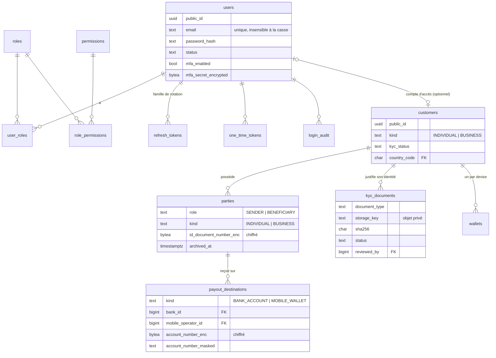
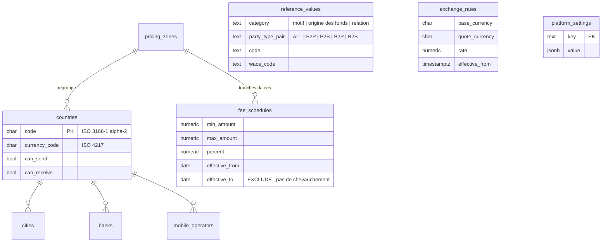
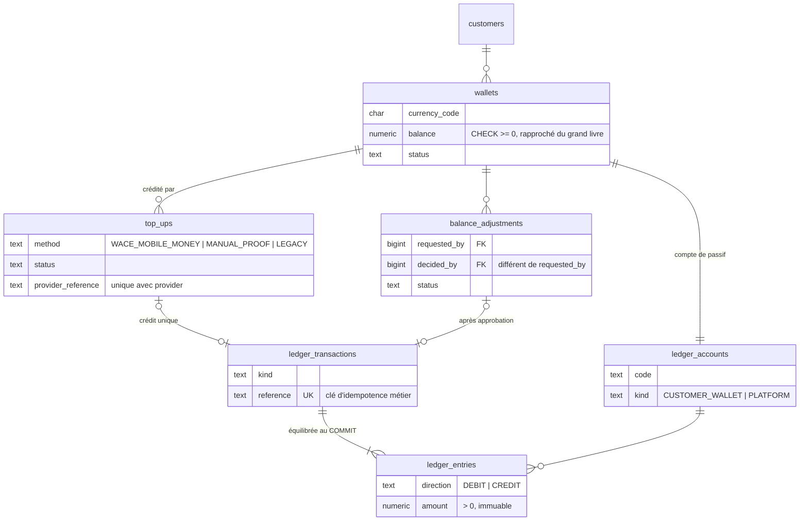
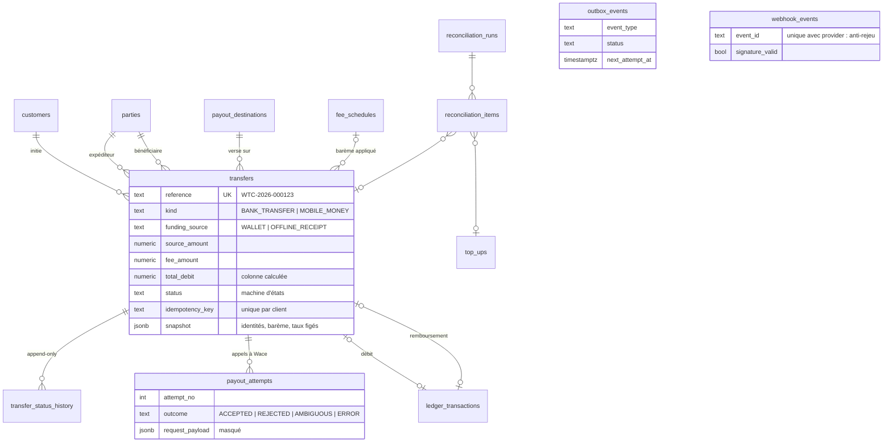
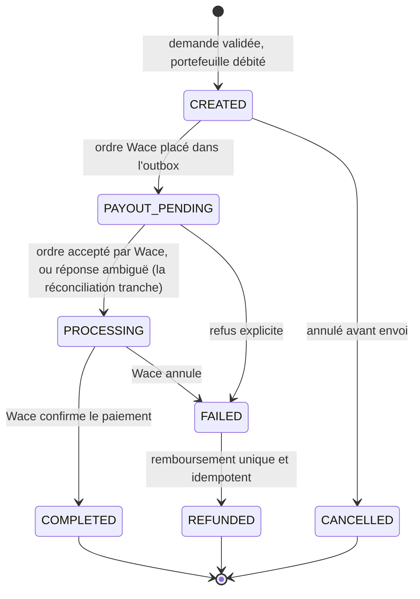

# Modèle de données cible — diagrammes

Source de vérité : [`V1__baseline.sql`](../../src/main/resources/db/migration/V1__baseline.sql) (38 tables, chargé et testé sur PostgreSQL 16 par `tools/check_schema.sh`, 55 invariants). Les diagrammes sont découpés par module ; les colonnes d'audit (`created_at`, `updated_at`, `version`) et les colonnes `legacy_*` ne sont pas répétées.

## 1. Identité et clients

## 2. Référentiels et tarification

## 3. Portefeuilles et grand livre

## 4. Transferts, envoi Wace et fiabilité

## Machine d'états d'un transfert

Règles : un transfert `REFUNDED` a toujours son écriture de remboursement ; `COMPLETED` a toujours `completed_at` ; `FAILED` et `REFUNDED` ont toujours un motif (contraintes `CHECK`, voir les invariants testés). Une réponse ambiguë de Wace ne déclenche **jamais** de remboursement : seul un statut confirmé (webhook, interrogation ou réconciliation) le permet.

## Comptes du grand livre : exemples d'écritures

| Événement | Débit | Crédit |
|---|---|---|
| Solde d'ouverture (migration) | `PLATFORM_OPENING_BALANCE` | portefeuille du client |
| Recharge Wace confirmée | `PLATFORM_TOPUP_CLEARING` | portefeuille du client |
| Transfert (montant) | portefeuille du client | `PLATFORM_PAYOUT_CLEARING` |
| Transfert (frais) | portefeuille du client | `PLATFORM_FEE_REVENUE` |
| Remboursement d'un transfert | `PLATFORM_PAYOUT_CLEARING` et `PLATFORM_FEE_REVENUE` | portefeuille du client |
| Saisie admin avec paiement hors plateforme | `PLATFORM_OFFLINE_RECEIPTS` | portefeuille du client, puis débit comme un transfert |
| Ajustement approuvé (crédit) | `PLATFORM_ADJUSTMENTS` | portefeuille du client |
